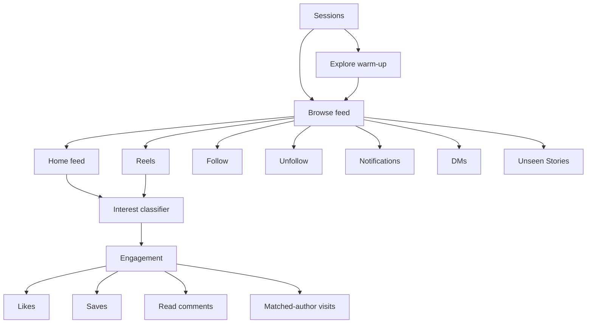

# Daily IG routines

The live browser header shows the current content's Interest match confidence and the AI profile category during follow screening. Results use the existing classifier calls, clear on navigation or advancement, and stay scoped to the current display lease. Profile categories are AI estimates, not verified personal attributes.

A session has one reservation, deadline, and shared activity budget. On days 1–4, Explore warm-up uses up to 30% of the available time to seed the selected interests, then returns to the common browsing flow. Brief unread-notification checks, inbox, unseen Stories, follow/DM batches, daily recipient-profile checks, and unfollow cleanup belong to that flow. Home feed and Reels are sibling actions; when both are enabled, the flow alternates them in time slices. Seen post/Reel identities persist across slices. Content actions do not navigate into other activities. Likes, saves, comment reading, and brief matched-author visits share the engagement module. Random profile wandering, unrelated liker/commenter visits, separate outreach likes, standalone Story nodes, and carousel probability/count settings are removed.

Three consecutive stalled browsing attempts end the session as stalled, preserving unused daily minutes for a later session. Successful browsing resets this limit. AI decisions may retry one temporary network, timeout, rate-limit, or gateway failure using the same model and screenshot. Both attempts share the original deadline, including the five-second interest-check limit; refusals, invalid responses, and authentication errors are not retried.

Create one automation per model. Select browsing surfaces, daily time, and session/rest ranges, then optionally enable Outreach. Outreach starts on warm-up day 8 once the account has at least three posts and its browser is logged in. Posting continues daily to the configured target without blocking outreach.

After the first seven warm-up days, each profile schedules one full rest day every 5–7 UTC calendar days. The interval is picked once and saved, then picked again after each rest day. Rest days have a zero-minute budget and skip all routine sessions. Today's existing budget stays unchanged.

Interests drive viewing and engagement in both Home feed and Reels. Every author, including followed accounts, needs a positive screenshot match when interests are selected. Off-topic content and failed decisions are skipped. With no interests, browsing stays passive. From day 2, positive matches can receive likes, saves, comment reading, and author visits within the shared daily action budgets. Random skip and engagement probabilities are removed. Reels use the generated browsing session deadline, with no min/max batch or daily view count limit. Old saved overrides are ignored. Story view timing is automatic. Stories are on by default and remain optional. They watch only accounts marked “not seen” for a random 1–3 minutes before browsing, bounded by the remaining session time. Empty or already-seen trays skip after at most two seconds; missing Next controls, finished playback, or transitions into previously seen accounts end the phase early. Autoplay transitions never receive an extra Next click. Story counts are recorded without a daily count ceiling. Home feed and Reels still have independent browsing toggles.

Profile outreach readiness is automatic; it has no manual toggle. Setup confirms the three-post requirement, and the routine unlocks lead follows and DMs on day 8 when the automation's Outreach setting is enabled. The profile's Logged in toggle remains available.

Warm-up engagement starts on day 2 and gradually follows topic-related accounts. The browsing flow mixes content viewing with lead outreach in batches of 3–5 completed follows/DMs, limited by the remaining quota and session time. Each batch starts after browsing and a 10–20 second pause before opening the first lead profile. Accounts within a batch keep the existing randomized pauses; excluded candidates do not count toward batch completion. The daily outreach target starts small, grows after confirmed outreach days, and stays within the configured maximum. Paused profiles do not run.

Add separate plain-English tags in Interests. Normal Luna rewrites each tag into a visible, editable intent description before it is saved. Commas remain inside a tag so combinations and exclusions are preserved. Matching accepts any one interest independently; it does not require every tag to match. Editing a tag rewrites its intent and regenerates cached search phrases. The model matches visible subjects, appearance, activities, and context. Visual interests such as beautiful women can qualify from the image alone, with no caption requirement. Everyday appearance terms describe visual presentation; the model does not infer sensitive identity traits or produce attractiveness ratings.

Topic post searches run only on warm-up days 1–4 to shape Instagram recommendations. Normal Luna generates search phrases from all saved interest descriptions. The worker opens Search, types a generated hashtag, presses Enter, and clicks its exact native result or the native suggested hashtag when no exact result exists. It never constructs a search URL. From day 5, browsing uses the enabled Home feed/Reels surfaces with the same screenshot interest rule. Topic account searches for verified follows continue through day 7 as a follow action in the shared browsing flow. Post likes have one owner: interest-based content engagement.

Explore inspects one visible row of up to four posts per request, adapting to the current layout. The screenshot is cropped to that row, numbered in memory, and compressed to at most 150,000 bytes. Luna Decisions answers independently for each tile so several or none can match. Only selected exact post links are opened; the opened media and caption get a second screenshot check before viewing or interacting. Grid reflow during capture skips the request. From day 2, matching Explore posts can receive budgeted interactions. Screenshots and numeric overlays are never written to the browser DOM or saved to disk.

Sidebar navigation works with both collapsed icons and expanded labels. Notification checks retry a changing control once, then skip the optional check if it stays unavailable. Temporary DOM visibility, detachment, and animation errors use the normal retry cooldown; saved errors of these kinds also recover. Login, checkpoint, and uncertain delivery issues still require attention.

Feed, profiles, overlays, and notification scanning use eased wheel scrolling. Cloak's unified action engine reveals controls inside their scroll container, moves the cursor, checks the target and emits input, while our thin adapter keeps the selected element and one shared deadline. No separate pre-click reveal, hover or surrogate CSS marker is needed. Reels select the video with the largest visible area, move the cursor over that video, and send one native downward wheel notch through the leased X11 display. Viewers without a native desktop bridge use the named Next button. A failed notch does not also click Next or send another notch. Advancement succeeds only after the URL changes and a visible frame stops moving; the frame need not be centered in the viewport. Failed advances log the stage and error; session expiry stops browsing without reporting a stuck reel. Notifications and inbox are checked at session startup, with no closing notification check. Explore opens a tile already near the viewport with a longer click budget; temporary search or Explore failures skip that phase and continue normal browsing. Every session uses the same bounded browsing retry loop. Story phase expiry skips the optional story; completed views count before optional engagement.

Visible automation sessions move the native desktop pointer along Cloak's mouse path before clicking. During Reels and Home feed scrolling, the cursor keeps its current safe position. Small movements of up to 45 pixels are considered at irregular 20–45 second intervals, using Cloak's humanized path. Interactions that leave the cursor outside visible content trigger repositioning before scrolling. TigerVNC includes that remote cursor in the stream; no cursor is injected into the page. The viewer hides its local cursor while the agent controls the session. Manual sessions keep normal cursor control.

The wrapper is CloakBrowser 0.6.3, with the Stable release channel selected explicitly and no browser version pin. Its action engine owns persona-aware whole-notch scrolling for automatic target reveal, human typing and mouse timing, scoped/role locators, and standard Playwright action errors. Our desktop adapter hooks the public `patchPage()` engine's `raw.move`, including existing and new pages. The X11 bridge remains necessary for the visible desktop pointer, OS wheel notches and Back. Playwright's `page.mouse.wheel()` is still passed through unchanged; the app's general scrolling retains its stop checks, completion predicate and session pacing. Screenshot crops, post/recipient identity checks, fingerprint seeds, browser resource leases and cleanup remain app responsibilities. See the [review of the latest eight releases](cloakbrowser-upgrade.md).

Reels, Home feed and Explore post dialogs use the post's Like button and confirm the resulting Unlike state. Like actions allow up to 15 seconds for cursor movement and clicking, bounded by the session deadline. Temporary engagement click or confirmation failures are logged and skipped; session expiry and Instagram account warnings still stop browsing.

Temporary story controls, week-one search/profile/Like work, and notification scans skip locally. A notification panel that survives Close and Escape is cleared by bounded Home navigation. Feed navigation/reload failures return a stalled result for the existing browsing retry loop; detached reel context skips to Next. DM preparation failures skip that recipient for the current session without recording delivery, and unscreened follow leases are released for backoff. Scans stay incomplete after failure. Account warnings, lost access, backend failures, and uncertain Follow or Send input still stop the session.

Detected ads skip locally before AI. Off-topic Reels and Home feed posts pause for a random 0.5–1.2 seconds after classification, then advance. The pause respects session expiry and stop requests. Home feed and rejected Explore rows use short eased wheel glides; Reels use one native wheel notch (or the named Next button without a desktop bridge) and verify navigation plus frame stability. Capture and classification share a five-second deadline; slow or unavailable decisions skip without ending the session.

Reels browsing reuses a healthy open viewer without clicking its sidebar link again. If its frame does not settle, reload it once and verify the visible frame again. Opening and recovery share one 15-second budget and respect session cancellation. Failed settling records the video bounds, scrollport bounds, and reason. Verified Reel transitions count as browsing progress even when skipping ads or off-topic reels, without counting them as watched reels. Failed opening logs its stage instead of waiting through repeated navigation attempts.

## Lead screening

Choose a scraped list, participating profiles, message, and allowed lead categories in Outreach. Male is the default; female and business can be selected independently. At least one category must be selected.

The scraper saves deduplicated likers as pending leads. There is no background enrichment. During outreach, the worker leases a candidate, opens its Instagram profile, waits for the correct profile header, takes a viewport screenshot, and sends it to the selected screening model through the existing OpenRouter key. Screenshots stay in memory and are not persisted or logged.

The model scores three categories from that screenshot alone: male, female, and business, using the username, full name, bio, profile picture and visible posts. The highest score wins, without a category confidence cutoff or priority override, and every decision gets a category. A male lead is then checked a second time on the same screenshot for clearly non-English text in the full name, bio or visible post captions and on-image text. The username is ignored. If any listed field contains non-English text with at least 70% probability, the lead fails the language check and is not screened again by that policy. English text is not required: empty fields, no posts and unidentifiable language pass this check. Provider errors and malformed answers still retry rather than approving a lead. Residence is not checked. An explicit refusal from the model skips the lead for good; any other failure preserves any saved decision and retries after five then ten minutes. Both models and every prompt, including the wording of each category choice, are editable per automation in AI settings; the three category keys and the language question stay fixed. Only the chosen model is asked, so a refusal or an error ends that attempt. Captures are cropped to 1568px wide because Jev cannot read wider images. Classification, confidence, the model that answered, and time are saved in the lead table. The Leads view shows when screening occurred.

A matching category receives a permanent sender assignment and one daily outreach slot. Excluded categories and failed screening do not consume quota. A known excluded category is not repeatedly opened by the same category policy; another eligible automation can screen it. An explicit refusal to answer a question sets `screeningRefused`, releases the lease, and permanently excludes the unassigned lead from every list's outreach pool. Bulk retry enrichment skips refused leads. Other provider failures preserve any saved decision, retry after five then ten minutes, and stop automatic screening after three consecutive failures. A successful decision resets the failure count; explicitly retrying ordinary failed enrichment also resets it. A two-minute lease expires after a crashed or interrupted worker. Stale results cannot overwrite a newer lease. Approval rechecks pause, list membership, category settings, day, and daily allowance.

The existing lead pool has been reset for browser screening. Assignments and outreach history are preserved. Retired lead picture fields are removed. Worker metadata and proxy assignments are maintained by ordinary writes, with no migration jobs or startup backfills.

## Outreach and cleanup

The Outreach tab has separate switches for following new leads and sending DMs from notification checks. Both default to on for existing routines and require Enable outreach. Turning off following stops screening, follow reservations, and new follows while notification DMs can continue for existing followed leads. Turning off notification DMs stops outreach notification discovery, own-post liker checks, and DM authorization while new follows can continue. Scheduled unfollows continue with either switch off. A follow-only routine does not require message text.

After screening, the worker follows both public and private recipients. Public posts can be browsed once before following; inaccessible private profiles receive a follow request. New follows never send a DM in the same visit. Confirmed follows and requests are recorded for cleanup. Starting the next calendar day, a completed daily notification scan queues followed leads who followed back, liked our post, or commented on our post. Only leads without a recorded sent DM qualify; blocked or previously claimed sends are also excluded, and authorization rechecks these conditions immediately before Send. Our follow or request must still exist. A follow-back notification is sufficient evidence of a reciprocal follow; the worker does not open or search the recipient's Following list. Follow-only matches still require an accessible profile. A post like or comment is an independent reason to message, even without a reciprocal follow; Message or Options → Send message must still open a composer. Requested alone never counts as approval or engagement. The worker types with keyboard events, clicks Send after fresh authorization, verifies delivery, and closes overlay chats with X. Full inbox threads return by clicking the recipient's native profile link. The worker waits briefly for the restored chat or Messages list and closes it with its own X before browsing continues. Multiline messages use Shift+Enter. There is no post-send reload or second post-browsing pass. A chat that cannot close stops further browsing. Confirmed follows advance the daily outreach ramp once per day. Approved claims remain permanent after an interrupted Instagram action, avoiding duplicate outreach.

Returning from the inbox chooses 50/50 between the recipient link in the chat header and View profile. If one is unavailable, the worker uses the other.

Before following a public lead, scroll its post list and randomly pick up to three of that account's posts. Open and view each post, then use the automation's Person detection model and prompt to check its main media before liking. Only direct photos or video frames of real people qualify; collages, graphics and toys do not. Failed or rejected decisions skip the Like. Close each viewer with X and return to the profile's Follow controls. Private and empty profiles skip post interaction. This runs only for new lead following; DM tasks and ordinary feed/Reel profile visits do not use it. Screenshots use the shared view capture and in-memory crop without changing the page layout.

`accountProgress.outreachIncrease` and `outreachQuotaDate` track the daily follow ramp and quota day. Each profile's daily target varies between the current ramp cap minus three and the cap itself, with a minimum of one: a cap of 10 gives 7–10, and a cap of 20 gives 17–20. Selection is stable for the profile and UTC date even before the first reservation; the first approved reservation saves it as `outreachAllowanceToday`. Later sessions and concurrent claims reuse it. Lowering the configured maximum clamps the saved target immediately; raising it applies when the next UTC day's target is selected. Notification- and snapshot-triggered DMs do not consume another follow slot. Per-route outreach messages stay in the automation settings.

Each recipient has its own `automation.recipient_session` event with navigation, screening, and follow timings, so later browsing cannot overwrite the lead's diagnostic notes. Recipient following has no separate post-like path.

Screenshot capture records its stage, elapsed time, and byte size. Each lead/topic Decisions call emits a correlated `automation.openrouter_decision` event with image byte size, JPEG header/end checks and dimensions when readable, request size, timeout, HTTP status, response type, provider/request IDs, retry timing, and sanitized upstream error fields. This distinguishes capture, network, timeout, HTTP, and JSON failures. Images, request payloads, API keys, and raw response bodies are not logged; echoed image data and credentials are redacted. The normal request deadline and retry behavior remain unchanged.

Scraping saves the lead's optional `isPrivate` flag from Instagram's liker response. Missing values stay unknown, including on existing leads. Before the first profile visit, roughly 30% of known public leads open through Search by typing the username and clicking its exact result; private and unknown leads use the direct URL. Screening and outreach then use that same visit. Missing or temporarily unavailable Search results fall back to the exact lead URL; checkpoints and stop requests prevent fallback and following.

The daily outreach notification scan uses the All filter and replaces the brief startup visit when follow-back tracking or eligible DM engagement needs it, even without an unread badge. Only completed scans save `lastNotificationsDate` and `lastNotificationsAt`; interrupted scans remain retryable. The first follow match saves `followBackAt`; post likes and comments save `postEngagement`. These events enable DM tasks for existing followed leads assigned to this sender and route. Grouped likes include only the usernames explicitly shown; hidden “others” are not inferred. Comment mentions, likes on comments, story reactions, and suggestions do not qualify. Older eligibility flags from the previous DM-first flow cannot authorize a message without qualifying engagement or follow-back evidence. Existing followed leads can qualify through notifications without resetting their history. Leads without qualifying engagement or follow-back evidence are not visited daily. Once a followed lead reaches its unfollow deadline it leaves the DM queue and enters cleanup. Already-unfollowed leads never reenter the queue. Sent, blocked and uncertain deliveries are excluded from automatic retries. A blocked message is recorded without attempting Unsend. Current category, sender, route and expiry are checked again before Send. The selected list message and its variations/placeholders are rendered once. An uncertain delivery stops that profile for review and is never blindly resent.

From day 8, a completed notification scan triggers the own-post liker check only when a like names an eligible lead we still follow and have not messaged. Matching uses the lead's current follow, sender, route, and DM state; there is no separate seen-notification registry. Empty scans, unrelated likes, follow-backs, comments, sent, blocked, uncertain, and expired leads do not trigger scraping. A triggered check reads the signed-in account's own post grid and reuses the liker scraper at most once per post per day, capped at 100 returned likers per post. Every request uses that exact owner's saved session and proxy, never another scraper account, and shares its hourly request budget and cooldown. Each post's first successful snapshot is a baseline and queues no DMs. Later snapshots compare Instagram user IDs with the previous snapshot; newly observed likers qualify only when they are already followed leads assigned to this sender and route. They enter the same guarded DM queue as notification likes. Instagram may return an incomplete or reordered list, so this detects newly observed IDs rather than proving when a like occurred. Failed scans keep completed post snapshots; a later qualifying notification scan can resume unchecked posts. Only a completed pass saves `lastLikerScanDate`. Notifications still detect follow-backs, comments, and explicitly named likes. Snapshot data is removed when its owning profile is deleted.

Notification-backed DMs do not require reading the signed-in username and can proceed without it. Own-post liker discovery still requires that lookup; if it fails, the optional scan remains retryable on a later qualifying notification scan while notification DMs and new follows continue. A stopped session never resumes actions after a failed lookup.

Confirmed follows or requests are removed after the configured unfollow delay. Cleanup runs in the same automation sessions and preserves sender history. Browsing, screening, follows, DMs, pauses, and cleanup share the session deadline. Rest releases the browser slot.

If a lead shows Instagram's “Sorry, this page isn't available” notice, continue the session. During scheduled unfollow cleanup, mark the lead as unfollowed and remove it from the cleanup queue while retaining sender, follow-date and delivery history. New-follow and DM visits skip the lead without changing its follow state. Each result logs the username and action. A missing control without that notice still raises an error; login challenges and stop requests remain session boundaries.

Analytics reports follow-back rates per account and across the workspace. Confirmed outreach follows and requests create daily cohorts; first detected follow-backs increment their original follow-date cohort exactly once. Pending means still followed without a detected follow-back. Unfollowing or removing a profile closes its pending count but preserves follows and conversions. Tracking starts with new confirmed outreach; older incomplete history is excluded and the UI shows the tracking start date. Date filters select follow dates, not notification dates; combined rates divide combined conversions by combined follows.

The once-daily follow-back scan is independent of DM delivery and the unread badge. Sent, blocked, expired, and already-unfollowed leads may still register a follow-back, but remain subject to the existing DM authorization rules. Only a successfully completed scan advances its date, and like-triggered scraping remains gated by DM eligibility.

Deploy matching Convex, server, and frontend changes together. No new manual login or API key is needed.

The Chats page and conversation APIs, message caches, archives, and attachment handlers are removed. Profiles show the last browser unread chat badge count next to their IG controls, with its check time in the tooltip. Every normal browser shutdown reads the message badge before closing and persists only the count and time. Missing UI, login/checkpoint pages, closed browsers, and failed checks keep the last known count. Unchecked profiles show a dash. This uses no mobile API requests.
